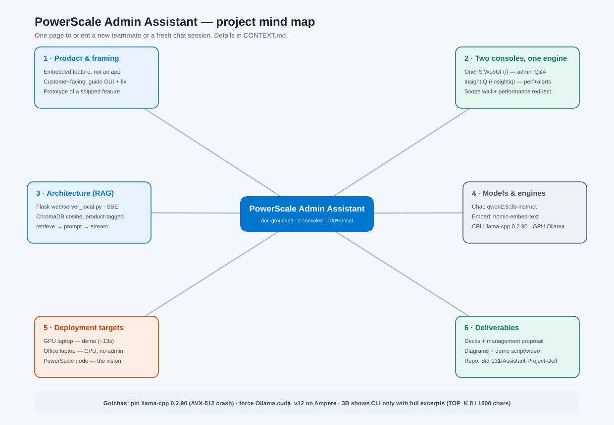

# Project Context — PowerScale Admin Assistant

**Read this first.** It orients a new teammate — or a fresh AI chat session — on what this project is, how it's built, and the decisions (and dead ends) behind it. Deep detail lives in [`README.md`](README.md); this is the map.



---

## 1. What it is (and isn't)

A **doc-grounded AI assistant embedded in Dell PowerScale's admin consoles**, built as a working local prototype. An administrator asks questions in plain English and gets answers drawn **only from official Dell documentation**, with citations — no internet, no cloud, nothing leaves the machine.

- It is a prototype of a **product feature** (an assistant *inside* the PowerScale consoles), **not** a standalone app. The local web app simulates how it would look embedded in the real console.
- It is **customer-facing**: the goal is to help an admin navigate the GUI and troubleshoot, at 2 a.m., without opening a support case.
- It is **read-only**: answers come from documentation. No live cluster calls, no actions.

## 2. Two assistants, one engine

| | Serves | Retrieves from |
|---|---|---|
| **OneFS WebUI** (`/`, `web/index.html`) | OneFS admin & config questions | **OneFS docs only** (the "scope wall") |
| **InsightIQ** (`/insightiq`, `web/insightiq.html`) | performance answers + "explain this alert" | **OneFS + InsightIQ docs** |

Both are served by the **same backend** (`web/server_local.py`). Two design points:
- **Scope wall** — retrieval is filtered by a `product` tag so the WebUI never answers from InsightIQ docs. InsightIQ keeps OneFS docs because "explain this alert" is grounded in the OneFS Event Reference.
- **Performance redirect** — ask the WebUI a performance question and it shows a card linking to InsightIQ instead of bluffing.

See the request-flow diagrams: [OneFS WebUI](diagrams/onefs-webui-assistant-flow.svg) · [InsightIQ](diagrams/insightiq-assistant-flow.svg) · [how it works, plain-English](diagrams/how-it-works.svg).

## 3. How it works (RAG)

`question → embed (nomic) → ChromaDB top-K (cosine, product-filtered) → build prompt with excerpts → LLM streams a cited answer over SSE`.

- Vector DB is **pre-built and bundled** (`app/chroma_db/`), collection `onefs_docs`, ~5,473 vectors, each tagged `product=onefs|insightiq`.
- Answers stream token-by-token (SSE). Sources shown when similarity ≥ 0.35; the "insufficient information" fallback suppresses citations.

## 4. Models & engines

- **Chat model: `qwen2.5:3b-instruct`.** Small and fast, and — unlike `llama3.2:3b` — it reliably emits the `isi` CLI command in a fenced block *when given the full excerpts*.
- **Embeddings: `nomic-embed-text`** (built the DB; must match at query time).
- **Two interchangeable engines, identical prompt:**
  - **in-process llama-cpp** (default, CPU) — the LLM runs inside `python.exe`, so no separate `.exe` for Device Guard / WDAC / AppLocker to block. This is the locked-down / office-laptop path.
  - **Ollama** (opt-in `USE_OLLAMA=1`) — offloads to an NVIDIA GPU. ~13s answers vs minutes.

## 5. Deployment targets

| Target | Engine | Speed | Role |
|---|---|---|---|
| **GPU laptop** (RTX 3050) | Ollama + GPU | ~13s, with CLI | demos & recording (`START-DEMO-GPU.bat`) |
| **Office laptop** (CPU, no admin) | in-process llama-cpp | ~1–3 min | the "no-admin, nothing-leaves-the-box" proof (`START.bat`) |
| **PowerScale node** (future) | CPU on-cluster | — | the real product vision; not built |

The office bundle runs from an unzipped `PowerScale-Suite\` folder, updated with `UPDATE-FROM-CLONE.bat`. The GPU laptop runs from this repo/clone.

## 6. Repo map

```
web/server_local.py     backend (dual engine, SSE, scope wall, redirect)
web/index.html          OneFS WebUI replica + assistant
web/insightiq.html      InsightIQ replica + assistant
ingest.py               build ChromaDB from OneFS docs
ingest_insightiq.py     add InsightIQ admin guide + performance reports
tag_products.py         tag every vector product=onefs|insightiq (the wall)
START.bat               launch (CPU)   ·   START-DEMO-GPU.bat  launch (GPU)
UPDATE-FROM-CLONE.bat   git pull + copy web app into a bundle
diagrams/               architecture + flow SVGs (+ this mind map)
deck/                   pitch + management decks (PptxGenJS)
management-doc/         management proposal (docx, no architecture)
demo/                   demo video script (+ recorded MP4)
```
**Gitignored (not in the repo):** `venv/`, `models_gguf/` (GGUF weights), `app/chroma_db/`, `docs/` (Dell PDFs). Rebuild via `download_docs.ps1` → `ingest.py`.

## 7. Run it

- **CPU:** double-click `START.bat` → http://localhost:8501
- **GPU:** double-click `START-DEMO-GPU.bat` (needs Ollama + NVIDIA GPU)
- **Health check:** `curl http://localhost:8501/api/health` → `{"ok":true,"engine":"llamacpp"|"ollama"}`

## 8. Hard-won gotchas (don't relearn these)

- **llama-cpp-python: pin `0.2.90`.** Newer wheels (0.3.32/0.3.33) are AVX-512 builds and crash with `0xc000001d` on 12th/13th-gen Intel consumer CPUs. 0.3.2 loads but is no faster.
- **Ollama on an Ampere GPU: force `cuda_v12`** (`set OLLAMA_LLM_LIBRARY=cuda_v12`). The auto-picked `cuda_v13` crashes with "shared object initialization failed".
- **CLI commands need full excerpts.** Truncating passages (`PROMPT_CHARS<1800`) or retrieving too few (`TOP_K<8`) clips `isi` commands off the end → the CLI block appears only sometimes. GPU defaults to 8×1800; on CPU set `TOP_K=8 PROMPT_CHARS=1800` (costs ~2–3 min).
- **`llama3.2:3b` never emits CLI** at any context size, on either engine. Qwen does.
- **On a 6 GB GPU, `llama3.1:8b` is *slower* than the 3B** (only 26/33 layers fit → CPU spillover). Smaller-but-resident beats bigger-but-partial.
- **CPU is prefill-bound** (~40 tok/s on both llama-cpp and Ollama-CPU) — there is no fast CPU path; the GPU is the only real speed-up.
- **OneDrive dehydrates model blobs** into cloud-only placeholders → "model not found" offline. Keep models on a local (non-OneDrive) path.
- **The `server.py` (LlamaIndex) backend was deleted** — its query engine silently dropped the system prompt, so it never produced CLI blocks. `server_local.py` is the one true backend.

## 9. Deliverables (for stakeholders)

- **Decks** (`deck/`): 10-slide + 5-slide pitch, 7-slide booth, and the **management concept-proposal deck** (answers a semi-technical exec review; no cost).
- **Management proposal** (`management-doc/`): business-level docx, deliberately no architecture.
- **Diagrams** (`diagrams/`): this mind map + two request-flow diagrams + the plain-English "how it works".
- **Demo** (`demo/`): a ~3:45 architecture-first video script (+ a recorded voiceover MP4).

## 10. Current state & what's NOT built

**Working end-to-end**, both consoles, both engines, on both laptops. Repo: `github.com/Sid-131/Assistant-Project-Dell` (private).

**Not built (deliberately scoped out / conceptual):**
- On-cluster deployment on real PowerScale hardware — the resource-governor / "storage stays P0" story is a *design intent* (there's a small `N_THREADS` governor in the code as a token of it), not a validated system.
- **Live telemetry** — InsightIQ answers today read *documentation* about performance and *mocked* report data; answering "why is *my* cluster slow right now" from live PAPI/telemetry is the hard, unbuilt 80%.
- The "1 in 5 support cases" figure is a **working estimate**, not a Dell-published stat.

## 11. Starting a new chat about this project

Point the new session here:
1. Read this file, then `README.md`.
2. The knowledge base and models are gitignored — a fresh clone needs `download_docs.ps1` → `ingest.py` → `ingest_insightiq.py` → `tag_products.py`, plus the GGUF models, before it can serve.
3. Run `curl /api/health` to see which engine is active.
4. The tuning knobs (`TOP_K`, `PROMPT_CHARS`, `USE_OLLAMA`, `N_THREADS`, `OLLAMA_CHAT_MODEL`) are documented in `README.md` → *Performance & tuning*.
